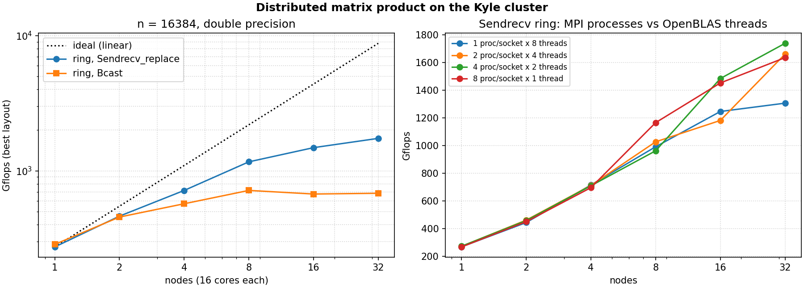
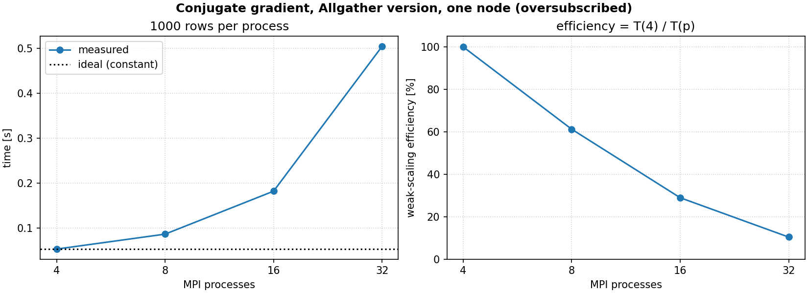

# MPI Parallel Linear Algebra

**Distributed dense matrix product and conjugate gradient in Python with mpi4py, benchmarked on
up to 32 nodes (512 cores) of an HPC cluster.**



| Component | What it does | Communication pattern |
|---|---|---|
| `ring_p2p` | C = A·B, blocks of A circulate around a ring of processes | `Sendrecv_replace` with the two neighbours |
| `ring_bcast` | same product, each block is broadcast in turn | `Bcast` (global synchronisation at every step) |
| `row_minimums` | minimum of every row of the distributed C | one `Reduce(MIN)` |
| `conjugate_gradient` | solves a sparse SPD system distributed by blocks of rows | 2 `Allreduce` per iteration + `Allgather` **or** halo exchange |

## Quick start

```bash
pip install -r requirements.txt
pytest                                   # 21 tests, run WITHOUT any MPI installation
mpirun -np 4 python scripts/matprod.py --size 2048 --p2p --bcast --min
mpirun -np 8 python scripts/cg_solve.py --rows-per-process 10000 --mode halo
```

On the cluster, `cluster/*.slurm` run the full benchmark campaigns
(`sbatch -N 8 -p cpu_prod cluster/matprod.slurm`).

### Testing MPI code without MPI

`mpi_linalg/comm.py` contains `ThreadComm`, a stand-in for `MPI.COMM_WORLD` where each rank is a
thread. It implements the mpi4py buffer methods used here (`Sendrecv`, `Sendrecv_replace`, `Bcast`,
`Reduce`, `Allreduce`, `Allgather`, `Barrier`). The unit tests run **the same algorithm functions**
as the cluster on 1 to 6 thread-ranks and compare the results with NumPy/SciPy. CI also runs a
smoke test under a real Open MPI runtime.

## 1. Ring matrix product

With `n` divisible by `P` and `m = n/P`, rank `r` owns rows `r·m … (r+1)·m` of A and the same
columns of B and C. Computing its columns of C needs **every** row block of A, so the blocks
travel:

```python
def ring_p2p(comm, A_r, B_r):
    owner = rank                                   # whose block of A we currently hold
    for _ in range(size):
        C_r[owner * m:(owner + 1) * m] = A_r @ B_r  # local BLAS product
        comm.Sendrecv_replace(A_r, dest=(rank - 1) % size, source=(rank + 1) % size)
        owner = (owner + 1) % size
```

After `P` steps every block has visited every rank, and each rank's block of A is back in place.
Each rank performs `2n³/P` flops and sends `n²` numbers in total.

**Results on the Kyle cluster** (n = 16 384, nodes with 2 × 8 cores, best of 4 process/thread layouts):

| nodes | 1 | 2 | 4 | 8 | 16 | 32 |
|---|---|---|---|---|---|---|
| `Sendrecv_replace` (Gflops) | 274 | 463 | 716 | 1 166 | 1 484 | **1 738** |
| speedup | 1.0 | 1.7 | 2.6 | 4.3 | 5.4 | 6.3 |
| `Bcast` (Gflops) | 286 | 455 | 571 | 717 | 674 | 683 |
| speedup | 1.0 | 1.6 | 2.0 | 2.5 | 2.4 | 2.4 |

* The point-to-point ring keeps scaling up to 32 nodes: at each step every process only talks to
  its two neighbours, and all these exchanges happen at the same time.
* The broadcast version stalls after 8 nodes: every step is a global synchronisation, and a
  broadcast to P processes costs `O(log P)` latency on top of the bandwidth term.
* Both remain far from linear, because the problem size is fixed (strong scaling): at 32 nodes with
  256 processes, each local product is a 64 × 16 384 block times a 16 384 × 64 block, too little
  work to hide the communication time.
* Splitting a node into more MPI processes with fewer OpenBLAS threads each (right panel) pays off
  beyond 8 nodes, probably because multithreaded BLAS is less efficient on such thin blocks.

## 2. Distributed conjugate gradient

Test problem: a sparse SPD tridiagonal system (1D Laplacian shifted by the identity, Dirichlet
condition on the first unknown), `b = 1`. Rank `r` builds **only its own rows**, directly from the
formula, as a sparse block, so memory per process is `O(n/P)` instead of `O(n²)` when the global
matrix is built and then sliced.

```python
for it in range(maxiter):
    Ap = op.matvec(p)                         # needs neighbours' entries of p
    alpha = rr / global_dot(comm, p, Ap)      # Allreduce 1
    x += alpha * p
    r -= alpha * Ap
    rr_new = global_dot(comm, r, r)           # Allreduce 2
    ...
```

Two ways to get the remote entries of `p` for the product:

* `allgather`: every rank rebuilds the full vector, so each process receives `O(n)` data at
  every iteration;
* `halo`: a tridiagonal row only couples neighbouring unknowns, so two `Sendrecv` calls exchanging
  **one number each** with the left and right neighbours are enough. That is `O(1)` data, with no
  global synchronisation.



The weak-scaling measurement above (1 000 rows per process, `allgather` version, one node
oversubscribed with up to 32 processes) shows the efficiency dropping to 10 % at 32 processes: the
`Allgather` volume grows with the global size, and every `Allreduce` is a global barrier. This
diagnosis motivated the two changes in this repository:

1. **Fewer reductions:** the textbook formulation used in class needed 5 `Allreduce` per iteration;
   the standard Hestenes–Stiefel recurrence used here needs 2.
2. **Halo exchange** instead of `Allgather` (`--mode halo`), which removes the `O(n)` gather entirely.

Both modes are tested against `scipy.sparse.linalg.spsolve`: they converge to the same solution in
the same number of iterations.
The weak-scaling campaign of the new version (`cluster/cg_weak_scaling.slurm`) has not been run on
the cluster yet, so no speed-up figure is claimed for it.

## Repository layout

```
mpi_linalg/
├── comm.py        # MPI constants + ThreadComm (thread-based ranks for tests)
├── matmul.py      # ring_p2p, ring_bcast, row_minimums, spot_check
└── cg.py          # row-block sparse matrix, Allgather / halo operators, conjugate gradient
scripts/           # mpirun entry points: matprod.py, cg_solve.py
cluster/           # SLURM batch scripts used for the benchmark campaigns
benchmarks/        # raw measurements (CSV) and the plotting script
reports/           # original lab reports (French)
tests/
```

## Context

Lab work for the HPC course of the CentraleSupélec engineering curriculum (Metz campus, Kyle
cluster), 2025–2026, done in pairs with **Adrien Lutz**. The original lab reports (French) are in
[`reports/`](reports/). The code was rewritten for this repository: the course skeleton was replaced
by a self-contained package, unit tests with thread-based ranks were added, and the conjugate
gradient was revised as described above.

## License

MIT, see [LICENSE](LICENSE).
